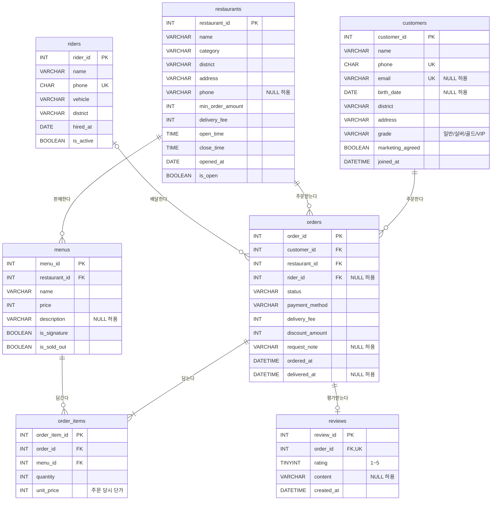

# 한입배달(hanip_deliveryNN) 데이터베이스

이 과정의 **유일한** 실습 DB입니다. 모든 챕터가 이 DB를 사용하며, 챕터별 setup 스크립트는 없습니다.## 설치 — 챕터마다 새 DB

이 과정은 **챕터마다 새 데이터베이스**를 만들어 수업 기록을 남깁니다. 테이블 구조와 시작 데이터는 모든 챕터가 같습니다.

| 챕터 | 실행 파일 | 생성 DB |
|---|---|---|
| Ch01 | `chapters/ch01-first-database/setup.sql` | `hanip_delivery01` |
| Ch02 | `chapters/ch02-select-basics/setup.sql` | `hanip_delivery02` |
| Ch03 | `chapters/ch03-functions/setup.sql` | `hanip_delivery03` |
| ChNN | `chapters/chNN-…/setup.sql` | `hanip_deliveryNN` |

- **Workbench**: setup.sql 열기 → ⚡ 전체 실행 (`Ctrl+Shift+Enter`)
- **명령줄**: `mysql -u root -p < chapters/ch01-first-database/setup.sql`
- 같은 챕터 DB가 이미 있으면 1007 에러로 멈춥니다(기록 보호). 해당 챕터를 초기화하려면 setup.sql 위쪽 `-- DROP DATABASE …` 줄의 주석을 풀고 다시 실행합니다.
- 수업 DB 목록: `SHOW DATABASES LIKE 'hanip_delivery%';`
- 학기 종료 후 정리: `DROP DATABASE hanip_delivery01;` … (되돌릴 수 없으니 백업 후)

| 이 폴더의 파일 | 용도 |
|---|---|
| `schema.sql` | 테이블 7개 정의 **원본** (직접 실행하지 않음) |
| `seed.sql` | 샘플 데이터 **원본** (직접 실행하지 않음) |

`tools/build.py`가 이 두 원본에 `CREATE DATABASE hanip_deliveryNN`을 붙여 각 챕터의 setup.sql을 만듭니다. 스키마나 데이터를 바꾸려면 원본을 고치고 빌드하세요. 열 정의를 바꾸고 싶다면 `schema.sql`, 데이터를 바꾸고 싶다면 `tools/gen_seed.py`를 수정합니다.


설치 확인 — 아래 결과가 똑같이 나오면 성공입니다.

```sql
SELECT 'customers' AS table_name, COUNT(*) AS row_count FROM customers
UNION ALL SELECT 'restaurants', COUNT(*) FROM restaurants
UNION ALL SELECT 'menus', COUNT(*) FROM menus
UNION ALL SELECT 'riders', COUNT(*) FROM riders
UNION ALL SELECT 'orders', COUNT(*) FROM orders
UNION ALL SELECT 'order_items', COUNT(*) FROM order_items
UNION ALL SELECT 'reviews', COUNT(*) FROM reviews;
```

<sub>▶ 실행 결과 · 7행</sub>

| table_name | row_count |
|---|---|
| customers | 30 |
| restaurants | 15 |
| menus | 70 |
| riders | 8 |
| orders | 563 |
| order_items | 1060 |
| reviews | 260 |


## ERD



## 금액 계산 규칙 (중요)

주문 금액은 테이블에 **저장되어 있지 않고 계산**합니다. 이 규칙은 4챕터부터 반복해서 씁니다.

| 용어 | 계산식 |
|---|---|
| 주문 상세 금액 | `order_items.quantity * order_items.unit_price` |
| 음식 금액 (주문 1건) | 해당 주문의 주문 상세 금액 합계 |
| 결제 금액 (주문 1건) | 음식 금액 + `orders.delivery_fee` − `orders.discount_amount` |
| 매출 집계 대상 | `orders.status = '배달완료'` 인 주문만 (취소·진행 중 제외) |

- `unit_price`는 **주문 당시 가격**입니다. 2026년 4~5월에 일부 메뉴 가격이 올랐기 때문에, 과거 주문의 `unit_price`는 현재 `menus.price`와 다를 수 있습니다.
- `orders.delivery_fee`는 실제로 부과된 배달팁입니다. 음식 금액 5만 원 이상이면 0원(무료 배달)입니다.

## 시간 기준

- 데이터 기간: **2026-01-01 ~ 2026-06-30**
- 스냅숏 시각: **2026-06-30 19:00** — 이 시각에 DB를 떠 왔다고 가정합니다.
- 수업의 "오늘"은 `'2026-06-30'`입니다. `NOW()` 대신 이 값을 씁니다.

## 상태값 (코드)

| 열 | 허용 값 |
|---|---|
| `restaurants.category` | 한식, 중식, 일식, 양식, 치킨, 피자, 분식, 카페·디저트 |
| `customers.grade` | 일반, 실버, 골드, VIP (상반기 결제 금액 순위로 부여) |
| `riders.vehicle` | 오토바이, 자전거, 도보 |
| `orders.status` | 접수 → 조리중 → 배달중 → 배달완료 / 취소 |
| `orders.payment_method` | 카드, 간편결제, 계좌이체, 현장결제 |

## 의도적으로 심어 둔 데이터 패턴

실무에서 쿼리를 틀리게 만드는 상황을 일부러 넣었습니다. 각 패턴을 처음 다루는 챕터를 함께 적었습니다.

| 패턴 | 데이터 | 다루는 챕터 |
|---|---|---|
| NULL 이메일·생년월일 | 고객 이메일 6명, 생년월일 3명 없음 | 02 `IS NULL`, 03 `IFNULL`, 04 `COUNT(열)` |
| NULL 설명·전화·요청사항 | 메뉴 설명, 가게 전화 2곳, 주문 요청사항 대부분 | 02, 03 |
| 주문 0건 고객 | 강도윤·조은서(오래된 미주문), 윤서아(6/28 신규 가입) | 05 LEFT JOIN, 06 NOT EXISTS |
| 주문 0건 가게 | 전포동오일파스타 (6/24 입점) | 05 LEFT JOIN |
| 주문 0건 메뉴 | 해운대스시하루 '특선 오마카세 도시락' + 신규 가게 메뉴 | 05, 06 |
| 폐업 가게 | 서면야식치킨 (`is_open = FALSE`, 3월까지만 주문) | 02, 04 월별 집계 |
| 활동 종료 기사 | 민경수 (`is_active = FALSE`, 2월까지만 배달) | 02, 05 |
| 휴면 고객 | 신동욱 (2월 8일 이후 주문 없음) | 03 날짜 차이, 06 |
| 가격 인상 | 돼지국밥·순대국밥·후라이드·양념(4/1), 물밀면·비빔밀면(5/1) | 05 `unit_price` vs `price`, 09 반정규화 |
| 품절 메뉴 | 3개 (`is_sold_out = TRUE`) | 02 |
| 자정 넘는 영업 | 대연동크런치치킨 ~02:00, 서면야식치킨 ~03:00 | 03 시간 비교 |
| 취소 주문 | 기사·배달시각 NULL | 04 매출 집계 조건 |
| 진행 중 주문 | 6/30 저녁 접수·조리중·배달중 각 1건 | 02, 04 |
| 지연 배달 | 60분 초과 배달, 별점이 낮은 경향 | 03 `TIMESTAMPDIFF`, 06 |
| 별점만 남긴 리뷰 | `content IS NULL` | 03, 04 |
| 무료 배달·할인 | 음식 5만 원 이상 배달팁 0원, 쿠폰 할인 | 04 결제 금액 |

```sql
SELECT
    (SELECT COUNT(*) FROM customers WHERE email IS NULL)      AS email_null,
    (SELECT COUNT(*) FROM menus WHERE is_sold_out = TRUE)      AS sold_out_menus,
    (SELECT COUNT(*) FROM orders WHERE status = '취소')         AS canceled_orders,
    (SELECT COUNT(*) FROM orders WHERE delivery_fee = 0)       AS free_delivery,
    (SELECT COUNT(*) FROM orders WHERE discount_amount > 0)    AS discounted,
    (SELECT COUNT(*) FROM reviews WHERE content IS NULL)       AS rating_only_reviews;
```

<sub>▶ 실행 결과 · 1행</sub>

| email_null | sold_out_menus | canceled_orders | free_delivery | discounted | rating_only_reviews |
|---|---|---|---|---|---|
| 6 | 3 | 49 | 67 | 113 | 50 |


## 재생성

시드 데이터는 `tools/gen_seed.py`가 고정된 난수 시드로 생성합니다. 같은 스크립트는 항상 같은 데이터를 만듭니다. 데이터를 바꾸려면 `seed.sql`을 직접 고치지 말고 생성기를 수정한 뒤 `python3 tools/gen_seed.py && python3 tools/build.py`로 교안 결과표까지 함께 갱신하세요.
