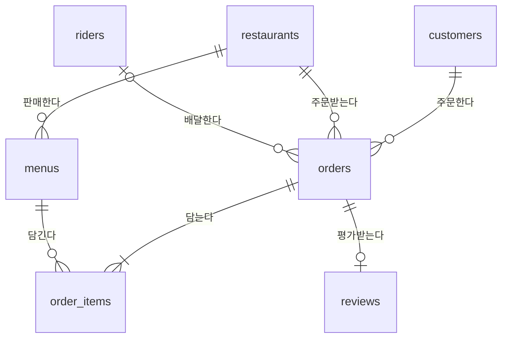
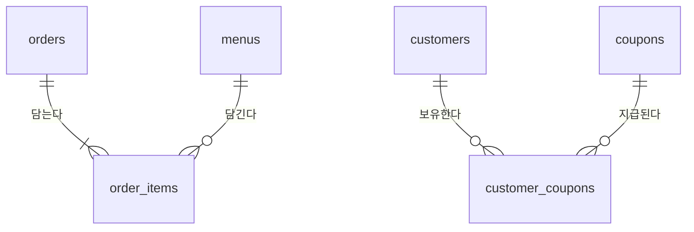
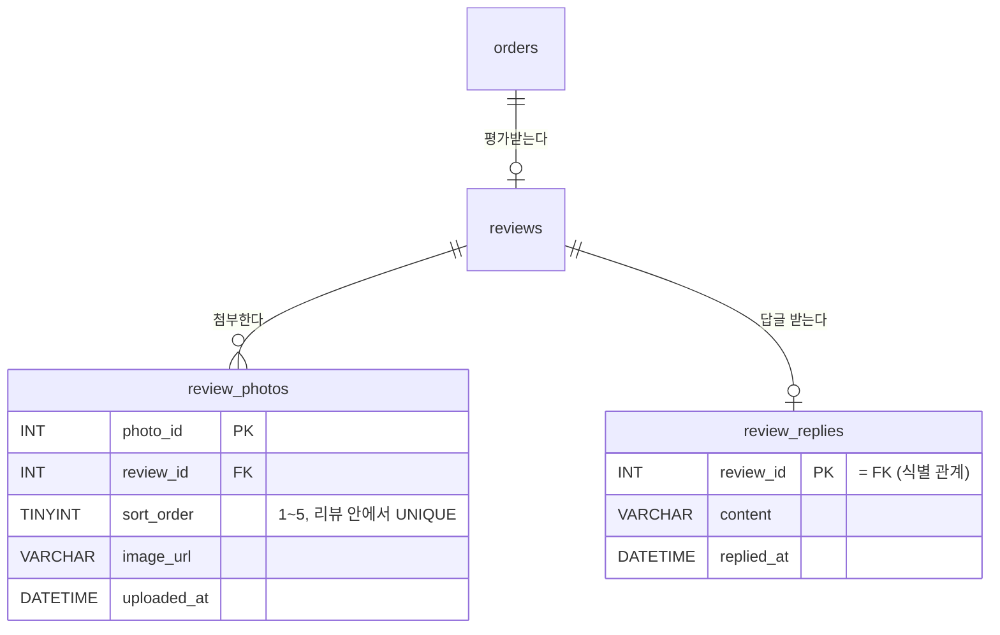

# Ch09. 데이터 모델링과 정규화

> **PART 3 · 설계와 운영** | 3시간 | 난이도 ★★★
> 이전: [Ch08. 데이터 변경과 트랜잭션](../ch08-dml-transaction/README.md) | 다음: [Ch10. 뷰·인덱스·사용자 관리](../ch10-view-index-user/README.md)

## 수업 준비

이 챕터 폴더의 **`setup.sql`**을 Workbench에서 열어 전체 실행(`Ctrl+Shift+Enter`)하세요. 오늘의 DB **`{{DB}}`**가 만들어집니다.

```sql
SHOW DATABASES LIKE 'hanip_delivery%';
USE {{DB}};
```

> 이번 setup.sql에는 쿠폰 테이블(Ch08)에 더해, 한입배달 초창기 정산팀이 쓰던 **엑셀 주문장** 두 장(6월 배달완료 주문)과 BCNF 실습용 **전속 기사 배정표**(`rider_assign`)가 들어 있습니다. `ex_`로 시작하는 테이블은 실습 문제용 시트입니다.

```sql run
SELECT 'order_sheet' AS table_name, COUNT(*) AS row_count FROM order_sheet
UNION ALL SELECT 'order_flat', COUNT(*) FROM order_flat
UNION ALL SELECT 'rider_assign', COUNT(*) FROM rider_assign;
```

## 오늘의 요청

> **From.** 데이터팀 김 팀장
>
> 신입 분석가들이 스키마를 보고 질문을 해요.
> - "주문 정보를 한 테이블에 다 넣으면 JOIN 안 해도 되고 편하지 않아요? 예전 엑셀 주문장처럼요."
> - "`order_items.unit_price`는 `menus.price`랑 똑같은 값인데 중복 아니에요?"
>
> 이 질문에 **근거를 들어** 답해 주세요. 그리고 다음 달 기능 두 개의 **ERD와 DDL**도 부탁합니다.
> 1. **리뷰 사진** — 리뷰 하나에 사진을 **최대 5장**까지, 올린 순서대로 보여 줘야 합니다.
> 2. **사장님 답글** — 리뷰 하나에 사장님이 답글을 **한 번만** 달 수 있습니다.

Ch07에서는 이미 정해진 테이블을 **만들었습니다**. 오늘은 그 테이블이 **왜 그렇게 나뉘었는지** 따져 보고, 같은 원리로 새 기능을 **설계합니다**. 답은 [7절](#7-오늘의-요청-해결--리뷰-사진과-사장님-답글).

## 학습 목표

1. 요구사항 → 개념 → 논리 → 물리 모델의 순서를 설명한다.
2. ERD에서 엔터티·속성·관계·**카디널리티**를 읽고, 그 관계를 쿼리로 확인한다.
3. 한 테이블에 여러 주제를 넣었을 때 생기는 **이상 현상**(갱신·삽입·삭제)을 직접 재현한다.
4. **함수 종속**과 **후보키**를 판별하고, 1NF → 2NF → 3NF → **BCNF**로 테이블을 직접 분해한다.
5. 우리 스키마에 일부러 남긴 중복(**반정규화**)의 이유를 설명한다.
6. 새 기능의 ERD를 그리고 제약조건까지 포함한 DDL로 옮긴다.

---

## 1. 모델링은 어떤 순서로 하나

테이블은 `CREATE TABLE`부터 쓰는 게 아닙니다. 건물을 지을 때 설계도부터 그리듯, 데이터도 **말 → 그림 → 표 → SQL** 순서로 내려갑니다.

| 단계 | 산출물 | 질문 | 한입배달 예 |
|---|---|---|---|
| 요구사항 분석 | 요구사항 문장 | 무엇을 기억해야 하나? | "고객은 가게에서 여러 메뉴를 주문한다" |
| **개념 모델링** | 엔터티 + 관계 (ERD 초안) | 어떤 **것**들이 있고 어떻게 엮이나? | 고객 ─< 주문 >─ 가게 |
| **논리 모델링** | 속성 · 식별자 · 정규화된 ERD | 각 것에 무엇을 저장하고 무엇으로 구별하나? | 주문(주문번호, 고객번호, 가게번호, 주문일시…) |
| **물리 모델링** | DDL (타입 · 제약조건 · 인덱스) | MySQL에서 어떻게 만드나? | `order_id INT AUTO_INCREMENT`, FK, CHECK |

> 요구사항 문장에서 **명사는 엔터티·속성 후보**, **동사는 관계 후보**입니다. "고객이 / 주문을 / 한다" → 고객, 주문 엔터티와 "한다" 관계.

Ch07은 물리 모델링이었고, 오늘은 그 위의 개념·논리 모델링입니다.

## 2. ERD 읽기

### 2-1. 엔터티 · 속성 · 식별자

| 용어 | 뜻 | 테이블로 옮기면 |
|---|---|---|
| 엔터티(Entity) | 저장할 가치가 있는 "것" (고객, 주문, 메뉴) | 테이블 |
| 속성(Attribute) | 엔터티의 성질 (이름, 가격) | 열 |
| 식별자(Identifier) | 엔터티 하나하나를 구별하는 속성 | PK |
| 관계(Relationship) | 엔터티끼리의 연결 (고객이 주문한다) | FK |

### 2-2. 관계와 카디널리티

**카디널리티**는 "한쪽 하나에 반대쪽이 몇 개 연결되는가"입니다. ERD에서는 선 끝 모양(까마귀발 표기법)으로 그립니다.

| 선 끝 | 읽는 법 | 뜻 |
|---|---|---|
| `\|\|` | 정확히 하나 | 반드시 1개 |
| `o\|` | 0 또는 1 | 없을 수도, 1개 |
| `\|{` | 1 이상 | 반드시 1개 이상 |
| `o{` | 0 이상 | 없을 수도, 여러 개 |

우리 스키마의 ERD입니다(전체 속성은 [database/README.md](../../database/README.md)).



`customers ||--o{ orders`는 양쪽에서 읽습니다. **주문 하나는 반드시 고객 한 명**의 것이고(`||`), **고객 한 명은 주문이 0개 이상**입니다(`o{`).

### 2-3. 카디널리티를 데이터로 확인하기

ERD의 선 끝은 그냥 그림이 아닙니다. 데이터가 정말 그런지 쿼리로 확인할 수 있습니다.

```sql run
SELECT
    (SELECT COUNT(*) FROM customers c
     WHERE NOT EXISTS (SELECT 1 FROM orders o WHERE o.customer_id = c.customer_id)) AS customers_without_order,
    (SELECT MIN(cnt) FROM (SELECT COUNT(*) AS cnt FROM order_items GROUP BY order_id) t) AS min_items_per_order,
    (SELECT MAX(cnt) FROM (SELECT COUNT(*) AS cnt FROM reviews GROUP BY order_id) t) AS max_reviews_per_order;
```

| 결과 | ERD 선 끝 | 무엇이 보장하나 |
|---|---|---|
| 주문 없는 고객이 있다 | 고객 쪽에서 본 주문 `o{` (0 이상) | 아무 제약 없음 (가입만 한 고객) |
| 주문마다 메뉴 줄이 최소 1개 | 주문 쪽에서 본 주문 상세 `\|{` (1 이상) | **DB는 못 막음** — 애플리케이션 · 트랜잭션(Ch08)이 보장 |
| 주문당 리뷰는 최대 1개 | 주문 쪽에서 본 리뷰 `o\|` (0 또는 1) | `uq_reviews_order` UNIQUE |

> "1 이상"(`|{`)은 FK·UNIQUE로 강제할 수 없습니다. 그래서 Ch08에서 주문과 주문 상세를 **한 트랜잭션**으로 묶었습니다. 모델링 결정이 SQL 작성 방식까지 정합니다.

### 2-4. M:N 관계는 연결 테이블로 푼다

주문 하나에 메뉴가 여럿, 메뉴 하나도 여러 주문에 담깁니다. **다대다(M:N)** 관계입니다. 관계형 DB는 M:N을 직접 저장하지 못하므로, 가운데 **연결 테이블**을 두어 1:N 두 개로 풉니다.



| M:N 관계 | 연결 테이블 | 연결 테이블에만 있는 속성 |
|---|---|---|
| 주문 ↔ 메뉴 | `order_items` | 수량, **주문 당시 단가** |
| 고객 ↔ 쿠폰 (Ch07) | `customer_coupons` | 지급일, 만료일, 사용한 주문 |

연결 테이블은 단순한 다리가 아니라 **관계 자체의 정보**를 담는 곳입니다. `quantity`는 주문의 성질도 메뉴의 성질도 아닌, "이 주문에 이 메뉴를 몇 개"라는 **관계의 성질**입니다.

### 2-5. 식별 관계와 비식별 관계

| 구분 | 자식의 PK | 예 |
|---|---|---|
| **식별 관계** | 부모의 PK를 **자기 PK에 포함** | `order_items` PK = (`order_id`, `menu_id`) |
| **비식별 관계** | 자기만의 PK, 부모 PK는 일반 FK | `order_items` PK = `order_item_id`, FK = `order_id` |

우리 `order_items`는 **비식별 관계**(대리키 `order_item_id`)를 택하고, 대신 `UNIQUE (order_id, menu_id)`로 "한 주문에 같은 메뉴 줄은 하나"를 지켰습니다. 대리키는 다른 테이블이 참조하기 쉽고, 키 구성이 바뀌어도 영향이 적습니다. 식별 관계는 7절에서 직접 써 봅니다.

### 2-6. Workbench로 ERD 뽑기 — Reverse Engineer

이미 있는 DB에서 ERD를 자동으로 그릴 수 있습니다.

1. Workbench 메뉴 **Database → Reverse Engineer…** (`Ctrl+R`)
2. 접속 선택 → **Next** → 스키마 목록에서 **`{{DB}}`** 체크 → **Next**
3. **Import MySQL Table Objects** 체크 → **Execute** → **Finish**
4. 테이블 상자와 FK 선이 그려진 ERD 창이 열립니다. 상자를 끌어 정리하고 **File → Export → PNG**로 저장

> 그려진 ERD에서 `order_sheet`와 `order_flat`은 **선 하나 없이 혼자 떠 있습니다.** 다른 어떤 테이블과도 관계를 맺지 않고 모든 정보를 혼자 들고 있다는 뜻입니다. 그게 무엇을 부르는지 3절에서 봅니다.

## 3. 엑셀 주문장의 문제 — 이상 현상

### 3-1. 한 칸에 메뉴를 몰아 쓴 주문장

정산팀 초창기 엑셀입니다. 주문 한 건이 한 행이고, 메뉴는 한 칸에 몰아 썼습니다.

```sql run limit=5
SELECT order_id, ordered_at, customer_name, restaurant_name, menu_list, delivery_fee
FROM order_sheet
ORDER BY order_id;
```

보기엔 편합니다. 그런데 정산팀이 묻습니다. **"6월에 물밀면 몇 그릇 팔렸어요?"**

```sql run
SELECT order_id, menu_list
FROM order_sheet
WHERE menu_list LIKE '%밀면%'
ORDER BY order_id;
```

- 수량이 글자 속에 묻혀 있어 `SUM`을 할 수 없습니다.
- `'%밀면%'`은 물밀면·비빔밀면·회밀면을 다 잡습니다. `'%물밀면%'`으로 좁혀도 행 개수 = 주문 수일 뿐, 그릇 수가 아닙니다.
- 누군가 "물밀면2"처럼 띄어쓰기를 빼먹으면 집계가 틀어집니다.

> 한 칸에 **값이 여러 개** 들어 있으면 SQL의 무기(WHERE, GROUP BY, SUM, JOIN)가 전부 무력해집니다. 이것이 **제1정규형(1NF) 위반**입니다.

### 3-2. 메뉴 한 줄 = 한 행으로 편 주문장

그래서 메뉴마다 한 행으로 폈습니다. PK는 (`order_id`, `menu_name`)입니다.

```sql run limit=4
SELECT order_id, menu_name, customer_name, customer_grade, restaurant_name, quantity, unit_price
FROM order_flat
ORDER BY order_id, menu_name;
```

```sql run
SELECT SUM(quantity) AS mul_milmyeon_sold
FROM order_flat
WHERE menu_name = '물밀면';
```

물밀면 질문은 해결됐습니다. 하지만 주문 456번의 고객 이름·등급·가게 이름이 **메뉴 줄 수만큼 반복**됩니다. 이 반복이 세 가지 사고를 부릅니다.

### 3-3. 갱신 이상 — 고친 곳만 고쳐진다

최수아 님이 6월에 7번 주문해 **실버 → 골드**로 승급했습니다. 상담원이 지금 보고 있는 최근 주문 한 건만 고쳤습니다. (확인 후 되돌릴 것이므로 트랜잭션 안에서 합니다.)

```sql run
START TRANSACTION;

UPDATE order_flat SET customer_grade = '골드'
WHERE order_id = 557;

SELECT customer_name, customer_grade, COUNT(*) AS line_count
FROM order_flat
WHERE customer_name = '최수아'
GROUP BY customer_name, customer_grade;
```

한 사람의 등급이 **두 개**가 됐습니다. "최수아 님 등급이 뭐예요?"에 DB가 답할 수 없습니다. 같은 사실이 여러 행에 있으면 **전부** 고쳐야 하고, 하나라도 빠뜨리면 데이터가 서로 모순됩니다.

```sql run
ROLLBACK;
```

### 3-4. 삽입 이상 — 주문이 없으면 메뉴도 못 넣는다

광안리화덕피자가 신메뉴 "고르곤졸라 피자"를 냈습니다. 아직 아무도 주문하지 않았습니다. 이 주문장에 메뉴를 등록할 수 있을까요?

```sql error
INSERT INTO order_flat (order_id, menu_name, ordered_at, customer_name, customer_phone,
                        customer_grade, restaurant_name, quantity, unit_price, delivery_fee)
VALUES (NULL, '고르곤졸라 피자', NOW(), '?', '?', '?', '광안리화덕피자', 0, 18000, 0);
```

주문 번호(PK)가 없으면 행을 만들 수 없습니다. 고객 이름·수량 같은 **있지도 않은 값**까지 지어내야 합니다. **원하는 정보만 따로 저장할 수 없는 것**이 삽입 이상입니다.

### 3-5. 삭제 이상 — 주문 하나 지웠더니 가게가 사라진다

해운대스시하루는 6월 주문이 단 한 건입니다. 그 주문이 착오로 확인돼 지웠습니다.

```sql run
START TRANSACTION;

DELETE FROM order_flat WHERE order_id = 501;

SELECT COUNT(*) AS rows_about_sushi_haru
FROM order_flat
WHERE restaurant_name = '해운대스시하루';
```

주문을 지웠을 뿐인데 **가게 전화번호, 메뉴 이름과 가격까지** 주문장에서 사라졌습니다. 지우려던 것보다 **더 많은 정보가 함께 지워지는 것**이 삭제 이상입니다.

```sql run
ROLLBACK;
```

### 3-6. 원인은 하나

| 이상 현상 | 증상 | 원인 |
|---|---|---|
| 갱신 이상 | 고객 등급이 두 개 | 고객 정보가 **주문 줄마다** 반복 |
| 삽입 이상 | 주문 없이 메뉴 등록 불가 | 메뉴 정보가 **주문에 붙어서만** 존재 |
| 삭제 이상 | 주문 삭제 → 가게 정보 소멸 | 가게 정보가 **주문에 붙어서만** 존재 |

`order_flat` 한 테이블에 **주문, 주문 줄, 고객, 가게** 네 가지 주제가 섞여 있습니다. 해결책은 주제별로 나누는 것, 즉 **정규화**입니다. 무엇을 기준으로 나눌지는 **함수 종속**이 알려 줍니다.

## 4. 함수 종속 — 무엇이 무엇을 결정하나

**X → Y** ("X가 Y를 결정한다"): X 값이 같으면 Y 값도 반드시 같다.

- `order_id → customer_phone`: 주문 번호가 같으면 고객 전화도 같다 (주문 하나에 고객 하나)
- `customer_phone → customer_name, customer_grade`: 전화가 같으면 같은 사람
- (`order_id`, `menu_name`) → `quantity`: 주문과 메뉴가 정해져야 수량이 정해진다

함수 종속은 **업무 규칙**에서 나오지만, 지금 데이터가 지키고 있는지는 쿼리로 검증할 수 있습니다. "같은 X인데 Y가 2개 이상인 X"를 세면 됩니다.

```sql run
SELECT
    (SELECT COUNT(*) FROM (SELECT order_id FROM order_flat GROUP BY order_id
                           HAVING COUNT(DISTINCT customer_phone) > 1) t) AS order_to_phone_violations,
    (SELECT COUNT(*) FROM (SELECT customer_phone FROM order_flat GROUP BY customer_phone
                           HAVING COUNT(DISTINCT customer_name) > 1) t) AS phone_to_name_violations,
    (SELECT COUNT(*) FROM (SELECT order_id FROM order_flat GROUP BY order_id
                           HAVING COUNT(DISTINCT restaurant_name) > 1) t) AS order_to_restaurant_violations;
```

모두 0, 즉 성립합니다. 반대로 **성립하지 않는** 종속도 있습니다. 메뉴 이름만으로 가게가 정해질까요?

```sql run
SELECT name AS menu_name, COUNT(*) AS restaurant_count
FROM menus
GROUP BY name
HAVING COUNT(*) > 1;
```

치킨집 두 곳에 같은 이름의 메뉴가 있습니다. `menu_name → restaurant`는 **성립하지 않습니다.** 메뉴를 구별하려면 (가게, 메뉴 이름)이 필요하고, 이게 번거로워 우리 스키마는 **`menu_id`** 대리키를 두었습니다(`uq_menus_name UNIQUE (restaurant_id, name)`로 조합 중복도 막음).

`order_flat`의 함수 종속을 정리하면 다음과 같습니다.

| 결정자 | 결정되는 속성 | 비고 |
|---|---|---|
| (`order_id`, `menu_name`) — PK 전체 | `quantity`, `unit_price` | 완전 종속 ✔ |
| `order_id` — PK의 **일부** | `ordered_at`, `customer_phone`, `restaurant_name`, `delivery_fee` | **부분 종속** → 2NF 위반 |
| `customer_phone` — 키가 아님 | `customer_name`, `customer_grade` | `order_id → phone → name` **이행 종속** → 3NF 위반 |
| `restaurant_name` — 키가 아님 | `restaurant_phone` | 이행 종속 → 3NF 위반 |

## 5. 정규화 — 1NF → 2NF → 3NF → BCNF

### 5-1. 제1정규형(1NF): 한 칸에 값 하나

| 위반 | 해결 |
|---|---|
| `menu_list = '돼지국밥 2, 수육 (중) 1'` (한 칸에 값 여러 개) | 값 하나 = 한 행 → `order_flat` |
| `photo1`, `photo2`, `photo3` 같은 반복 열 | 값 하나 = 한 행, 별도 테이블로 (7절 리뷰 사진에서 다시) |

`order_flat`은 정산팀이 손으로 다시 친 시트입니다. 그런데 `order_sheet`만 있었다면? **SQL로 직접 펼 수 있습니다.** 재료는 Ch03의 `SUBSTRING_INDEX`와 Ch06의 `UNION ALL`입니다.

**① 칸 속 값을 n번째 조각으로 자르기.** `SUBSTRING_INDEX(문자열, ', ', n)`은 n번째 구분자 앞까지, 거기에 다시 `-1`을 주면 그중 마지막 조각입니다. 번호표(1, 2, 3)를 JOIN해서 주문 한 행을 메뉴 개수만큼 복제합니다.

```sql run limit=6
SELECT s.order_id, seq.n,
    SUBSTRING_INDEX(SUBSTRING_INDEX(s.menu_list, ', ', seq.n), ', ', -1) AS item
FROM order_sheet s
JOIN (SELECT 1 AS n UNION ALL SELECT 2 UNION ALL SELECT 3) seq
  ON seq.n <= (CHAR_LENGTH(s.menu_list) - CHAR_LENGTH(REPLACE(s.menu_list, ', ', ''))) / 2 + 1
ORDER BY s.order_id, seq.n;
```

> `ON` 조건은 "쉼표 개수 + 1 = 메뉴 개수"까지만 번호표를 붙이라는 뜻입니다. `', '`가 두 글자라서 줄어든 길이를 2로 나눕니다. 한 주문에 메뉴가 최대 3개라 번호표도 3까지면 충분합니다.

**② 조각을 이름과 수량으로 나누기.** 마지막 공백 뒤가 수량, 그 앞이 메뉴 이름입니다(`수육 (중) 1`처럼 이름에 공백이 있어도 마지막 공백 기준이라 안전).

```sql run
WITH pieces AS (
    SELECT s.order_id,
        SUBSTRING_INDEX(SUBSTRING_INDEX(s.menu_list, ', ', seq.n), ', ', -1) AS item
    FROM order_sheet s
    JOIN (SELECT 1 AS n UNION ALL SELECT 2 UNION ALL SELECT 3) seq
      ON seq.n <= (CHAR_LENGTH(s.menu_list) - CHAR_LENGTH(REPLACE(s.menu_list, ', ', ''))) / 2 + 1
), menu_lines AS (
    SELECT order_id,
        LEFT(item, CHAR_LENGTH(item) - CHAR_LENGTH(SUBSTRING_INDEX(item, ' ', -1)) - 1) AS menu_name,
        CAST(SUBSTRING_INDEX(item, ' ', -1) AS UNSIGNED) AS quantity
    FROM pieces
)
SELECT COUNT(*) AS line_rows,
    (SELECT COUNT(*) FROM order_flat) AS order_flat_rows,
    SUM(CASE WHEN menu_name = '물밀면' THEN quantity END) AS mul_milmyeon_sold
FROM menu_lines;
```

펼친 행 수가 `order_flat`과 같고, 3-1절에서 못 구했던 **물밀면 판매 그릇 수**가 한 번에 나옵니다. 이렇게 한 칸에 하나씩만 들어 있는 상태가 1NF이고, 그다음부터는 **키**를 기준으로 나눕니다.

> 실무에서는 이 펴기 쿼리를 **한 번만** 돌려 새 테이블로 옮기고(`CREATE TABLE … AS SELECT`), 그 뒤로는 1NF 테이블에만 씁니다. 매번 문자열을 자르는 건 임시방편입니다.

### 5-2. 제2정규형(2NF): 부분 종속 제거

PK의 **일부**(`order_id`)에만 종속된 속성을 떼어 냅니다. 떼어 낸 쪽은 `order_id`가 PK가 됩니다.

```sql run
CREATE TABLE nf_orders AS
SELECT DISTINCT order_id, ordered_at, customer_phone, customer_name, customer_grade,
    restaurant_name, restaurant_phone, delivery_fee
FROM order_flat;

CREATE TABLE nf_order_items AS
SELECT order_id, menu_name, quantity, unit_price
FROM order_flat;

SELECT (SELECT COUNT(*) FROM nf_orders) AS orders_rows,
       (SELECT COUNT(*) FROM nf_order_items) AS items_rows;
```

> `CREATE TABLE … AS SELECT`(CTAS)는 조회 결과로 새 테이블을 만듭니다. 열과 데이터는 복사되지만 **PK·FK 같은 제약조건은 복사되지 않으니** 필요하면 ALTER로 추가합니다.

이제 주문 정보는 주문당 1행입니다. 178행에 반복되던 고객·가게 정보가 97행으로 줄었습니다.

### 5-3. 제3정규형(3NF): 이행 종속 제거

`nf_orders`에서 `order_id → customer_phone → customer_name, customer_grade`입니다. 키가 아닌 열(`customer_phone`)이 다른 열을 결정하고 있으므로 고객을 떼어 냅니다. 가게도 같습니다.

```sql run
CREATE TABLE nf_customers AS
SELECT DISTINCT customer_phone, customer_name, customer_grade FROM nf_orders;

CREATE TABLE nf_restaurants AS
SELECT DISTINCT restaurant_name, restaurant_phone FROM nf_orders;

ALTER TABLE nf_customers   ADD CONSTRAINT pk_nf_customers   PRIMARY KEY (customer_phone);
ALTER TABLE nf_restaurants ADD CONSTRAINT pk_nf_restaurants PRIMARY KEY (restaurant_name);
ALTER TABLE nf_orders DROP COLUMN customer_name, DROP COLUMN customer_grade, DROP COLUMN restaurant_phone;

SELECT (SELECT COUNT(*) FROM nf_customers) AS customers_rows,
       (SELECT COUNT(*) FROM nf_restaurants) AS restaurants_rows;
```

PK 추가가 성공했다는 것 자체가 검증입니다. 같은 전화번호에 다른 이름·등급이 섞여 있었다면 `DISTINCT` 결과에 중복 전화가 생겨 **1062 에러**가 났을 겁니다. 3-3절의 갱신 이상을 ROLLBACK하지 않았다면 바로 여기서 터졌습니다.

이제 최수아 님 등급은 **`nf_customers`의 한 행**만 고치면 됩니다. 갱신 이상이 구조적으로 불가능해졌습니다.

### 5-4. 다시 조립해도 같은가 — 무손실 분해

나눈 테이블을 JOIN하면 원래 주문장이 **한 행도 빠짐없이, 더해지지도 않고** 돌아와야 합니다. `EXCEPT`(MySQL 8.0.31+)로 양쪽 차이를 확인합니다.

```sql run
SELECT COUNT(*) AS lost_rows
FROM (
    SELECT order_id, menu_name, customer_name, restaurant_phone, quantity
    FROM order_flat
    EXCEPT
    SELECT o.order_id, i.menu_name, c.customer_name, r.restaurant_phone, i.quantity
    FROM nf_orders o
    JOIN nf_order_items i ON o.order_id        = i.order_id
    JOIN nf_customers   c ON o.customer_phone  = c.customer_phone
    JOIN nf_restaurants r ON o.restaurant_name = r.restaurant_name
) diff;
```

0행입니다. 정보를 잃지 않고 나눴습니다(**무손실 분해**). 정규화는 데이터를 버리는 게 아니라 **같은 사실을 한 곳에만 두는 것**입니다.

### 5-5. 결과는 우리 스키마다

| 정규화로 만든 테이블 | 우리 스키마 | 우리 스키마가 더 한 것 |
|---|---|---|
| `nf_orders` | `orders` | 고객·가게를 **번호(FK)**로 참조, 상태·결제수단 |
| `nf_order_items` | `order_items` | 메뉴를 `menu_id`로 참조 (이름 중복 문제 해결) |
| `nf_customers` | `customers` | 전화 대신 `customer_id` 대리키 (번호는 바뀔 수 있으니까) |
| `nf_restaurants` | `restaurants` | `restaurant_id` 대리키 |
| (주문 없으면 저장 불가였던 메뉴) | `menus` | 주문과 무관하게 메뉴 등록 가능 → 삽입 이상 해결 |

> 신입 분석가의 첫 질문 "한 테이블에 다 넣으면 편하지 않아요?"의 답: **읽기는 편해 보이지만 쓰기가 위험합니다.** 고칠 때마다 모순(갱신 이상), 넣을 수 없는 정보(삽입 이상), 지우면 함께 사라지는 정보(삭제 이상)가 생깁니다. JOIN은 그 안전의 대가입니다.

### 5-6. BCNF: 모든 결정자가 후보키

3NF까지 오면 대부분 끝납니다. 그런데 **3NF인데도 이상 현상이 남는** 테이블이 있습니다. 한입배달 초창기, 기사가 가게에 **전속**이던 시절의 배정표입니다.

```sql run
SELECT * FROM rider_assign ORDER BY restaurant_name, customer_name;
```

업무 규칙은 두 개입니다.

1. 고객은 **가게마다** 담당 기사가 한 명이다 → (`customer_name`, `restaurant_name`) → `rider_name`
2. 기사는 **한 가게에만** 속한다 → `rider_name` → `restaurant_name`

**후보키부터 찾습니다.** 후보키는 "행을 하나로 특정하는 최소한의 열 조합"입니다. PK인 (고객, 가게) 말고도, 규칙 2 때문에 (고객, 기사)를 알면 가게가 정해지므로 (고객, 기사)도 후보키입니다. 데이터로 확인합니다.

```sql run
SELECT COUNT(*) AS total_rows,
    COUNT(DISTINCT customer_name, restaurant_name) AS by_customer_restaurant,
    COUNT(DISTINCT customer_name, rider_name)      AS by_customer_rider,
    COUNT(DISTINCT rider_name)                     AS by_rider,
    (SELECT COUNT(*) FROM (SELECT rider_name FROM rider_assign GROUP BY rider_name
                           HAVING COUNT(DISTINCT restaurant_name) > 1) t) AS rider_to_restaurant_violations
FROM rider_assign;
```

전체 행 수와 같은 조합이 후보키입니다. 그리고 `rider_name → restaurant_name`이 성립합니다(위반 0).

**정규형을 판정합니다.**

| 검사 | 결과 | 이유 |
|---|---|---|
| 1NF | ✔ | 한 칸에 값 하나 |
| 2NF | ✔ | 키가 아닌 열(비주요 속성)이 **하나도 없음** — 세 열 모두 어떤 후보키의 일부 |
| 3NF | ✔ | 같은 이유로 이행 종속될 비주요 속성이 없음 |
| **BCNF** | ✘ | `rider_name`이 `restaurant_name`을 **결정**하는데, `rider_name`은 **후보키가 아님** |

3NF는 "키가 아닌 열이 키가 아닌 열을 결정하지 말라"였습니다. 여기서 결정되는 `restaurant_name`은 후보키의 일부라 3NF는 이걸 문제 삼지 않습니다. BCNF는 더 단순하고 엄격합니다. **무엇을 결정하는 열(결정자)이면 무조건 후보키여야 한다.**

**그래서 이상 현상이 남습니다.** 하민호 기사가 해운대명가밀면으로 옮기면?

```sql run
SELECT rider_name, restaurant_name, COUNT(*) AS rows_to_update
FROM rider_assign
WHERE rider_name = '하민호'
GROUP BY rider_name, restaurant_name;
```

"하민호는 어느 가게 소속"이라는 사실 하나가 3행에 흩어져 있습니다(갱신 이상). 신입 기사 민경수가 전포카츠에 왔는데 아직 담당 고객이 없으면 등록할 수 없고(삽입 이상), 곽태호의 유일한 고객 박지훈이 떠나면 "곽태호는 해운대명가밀면 소속"이라는 정보도 사라집니다(삭제 이상).

**BCNF로 분해합니다.** 위반한 종속 `rider_name → restaurant_name`을 따로 떼고, 원래 테이블에는 결정자(`rider_name`)만 남깁니다.

```sql run
CREATE TABLE nf_riders AS
SELECT DISTINCT rider_name, restaurant_name FROM rider_assign;

CREATE TABLE nf_customer_riders AS
SELECT customer_name, rider_name FROM rider_assign;

ALTER TABLE nf_riders          ADD CONSTRAINT pk_nf_riders          PRIMARY KEY (rider_name);
ALTER TABLE nf_customer_riders ADD CONSTRAINT pk_nf_customer_riders PRIMARY KEY (customer_name, rider_name);

SELECT (SELECT COUNT(*) FROM nf_riders) AS riders_rows,
       (SELECT COUNT(*) FROM nf_customer_riders) AS customer_riders_rows;
```

이제 하민호의 소속은 `nf_riders` **한 행**이고, 고객이 없는 기사도 `nf_riders`에 등록할 수 있습니다. 두 테이블의 공통 열 `rider_name`이 `nf_riders`의 PK라서 JOIN하면 원래대로 돌아옵니다(무손실).

```sql run
SELECT COUNT(*) AS lost_rows
FROM (
    SELECT customer_name, restaurant_name, rider_name FROM rider_assign
    EXCEPT
    SELECT cr.customer_name, r.restaurant_name, cr.rider_name
    FROM nf_customer_riders cr
    JOIN nf_riders r ON cr.rider_name = r.rider_name
) diff;
```

**대가도 있습니다.** 규칙 1 "고객은 가게마다 기사 한 명"은 원래 PK (고객, 가게)가 지켜 주었습니다. 나눈 뒤에는 (고객, 가게)가 **한 테이블에 함께 있지 않아서** 어떤 키도 이 규칙을 지키지 못합니다.

```sql run
START TRANSACTION;

INSERT INTO nf_customer_riders VALUES ('김민준', '노지환');   -- 노지환도 서면옛날돼지국밥 소속

SELECT cr.customer_name, r.restaurant_name, COUNT(*) AS rider_count
FROM nf_customer_riders cr
JOIN nf_riders r ON cr.rider_name = r.rider_name
GROUP BY cr.customer_name, r.restaurant_name
HAVING COUNT(*) > 1;
```

에러 없이 들어갔고, 김민준 님에게 서면옛날돼지국밥 담당 기사가 **두 명**이 됐습니다. BCNF 분해는 항상 무손실이지만 **함수 종속을 보존하지 못할 수 있습니다.** 3NF 분해는 항상 둘 다 지킬 수 있습니다.

```sql run
ROLLBACK;
```

| 선택 | 얻는 것 | 잃는 것 | 빈틈 메우기 |
|---|---|---|---|
| 3NF에서 멈춤 (`rider_assign` 유지) | 규칙 1을 PK가 지킴 | 기사 소속의 갱신·삽입·삭제 이상 | 기사 테이블(`rider_name` PK)을 따로 두고, `rider_assign`의 (기사, 가게)를 **복합 FK**로 그 테이블에 연결 |
| BCNF로 분해 | 기사 소속 이상 제거 | 규칙 1을 키로 못 지킴 | 트리거(Ch11)나 프로시저(Ch12)로 검사 |

> 실무 기본값은 **BCNF까지 나누고, 잃은 규칙은 다른 방법으로 지키기**입니다. 다만 잃는 규칙이 핵심 규칙이면 3NF에서 멈추기도 합니다. 어느 쪽이든 **무엇을 포기했는지 알고** 선택해야 합니다.

### 5-7. 정규형 판정 순서와 시험 포인트

테이블 하나를 받으면 이 순서로 묻습니다.

1. **한 칸에 값이 하나인가?** 아니면 비정규형 → 행으로 펴기 (1NF)
2. **후보키를 모두 찾았나?** 행 수 = `COUNT(DISTINCT 조합)`인 최소 조합. 이후 판정은 전부 후보키 기준
3. **후보키의 일부에만 종속된 비주요 속성이 있나?** 있으면 2NF 위반 → 그 일부를 키로 떼어 내기
4. **비주요 속성이 비주요 속성을 결정하나?** 있으면 3NF 위반 → 결정하는 열을 키로 떼어 내기
5. **후보키가 아닌 결정자가 남았나?** 있으면 BCNF 위반 → 그 결정자를 키로 떼어 내기

| 정규형 | 제거 대상 | 한 줄 요약 | 오늘의 예 |
|---|---|---|---|
| 1NF | 반복 그룹 · 다중값 | 한 칸에 값 하나 | `order_sheet` → `order_flat` |
| 2NF | 부분 함수 종속 | 키 **전체**에 종속 | `order_id`에만 종속된 열 → `nf_orders` |
| 3NF | 이행 함수 종속 | 키 **말고는** 아무것도 결정하지 않음 | 고객 · 가게 분리 |
| BCNF | 후보키가 아닌 결정자 | **모든 결정자가 후보키** | `rider_assign` → 기사 분리 |

- 정보처리기사 단골: **1NF 원자값 → 2NF 부분 함수 종속 제거 → 3NF 이행 함수 종속 제거 → BCNF 결정자가 후보키** → 4NF 다치 종속 → 5NF 조인 종속. 순서와 키워드를 짝지어 외우세요. ("도부이결다조")
- 4NF · 5NF는 실무에서 드뭅니다. 3NF와 BCNF를 **직접 판정하고 분해할 수 있으면** 충분합니다.

## 6. 반정규화 — 일부러 남긴 중복

정규화는 중복을 없애지만, 실무에서는 **성능이나 업무 의미 때문에** 일부러 중복을 남기기도 합니다. 이것이 반정규화(비정규화)입니다. 우리 스키마에도 있습니다.

### 6-1. `order_items.unit_price` — 사실 중복이 아니다

신입 분석가의 두 번째 질문입니다. 돼지국밥이 실제로 얼마에 팔렸는지 보겠습니다.

```sql run
SELECT oi.unit_price, m.price AS current_price,
    COUNT(*) AS line_count, MIN(o.ordered_at) AS first_order, MAX(o.ordered_at) AS last_order
FROM order_items oi
JOIN orders o ON oi.order_id = o.order_id
JOIN menus  m ON oi.menu_id  = m.menu_id
WHERE oi.menu_id = 1
GROUP BY oi.unit_price, m.price
ORDER BY first_order;
```

4월 1일에 9,000원 → 10,000원으로 올랐습니다. `unit_price`는 **"그 주문 시점의 가격"**이라는 **다른 사실**이고, 메뉴의 현재 가격과 값이 같을 때가 많을 뿐입니다. 함수 종속으로 말하면 `menu_id → price`(현재가)와 (`order_id`, `menu_id`) → `unit_price`(판매가)는 결정자가 다릅니다.

만약 `unit_price` 없이 현재 가격으로 매출을 계산했다면?

```sql run
SELECT
    SUM(oi.quantity * oi.unit_price) AS real_sales,
    SUM(oi.quantity * m.price)       AS sales_by_current_price,
    SUM(oi.quantity * m.price) - SUM(oi.quantity * oi.unit_price) AS overstated
FROM order_items oi
JOIN orders o ON oi.order_id = o.order_id
JOIN menus  m ON oi.menu_id  = m.menu_id
WHERE o.status = '배달완료'
  AND o.ordered_at < '2026-04-01';
```

1분기 매출이 부풀려집니다. 정산이 틀리고, 지난달 영수증 금액이 가격 인상과 함께 **소급해서 바뀝니다.** 그래서 주문 당시 값은 반드시 복사해 둡니다(Ch08에서 `price`를 `unit_price`로 복사한 이유).

> 같은 이유로 배달팁도 `restaurants.delivery_fee`(현재 정책)와 `orders.delivery_fee`(그 주문에 실제 받은 금액)가 따로 있습니다.

### 6-2. `orders.restaurant_id` — 계산할 수 있지만 남겼다

주문의 가게는 `order_items → menus → restaurant_id`로 **알아낼 수 있습니다.** 엄밀히는 중복입니다. 그래도 남긴 이유:

1. **자주 쓴다** — 가게별 매출·주문 수는 가장 흔한 질문. 매번 두 번 JOIN하지 않아도 됨
2. **업무 규칙** — "한 주문은 한 가게"를 주문 머리에서 바로 표현 (메뉴 줄이 생기기 전에도 가게가 정해짐)

중복을 남겼다면 **어긋나지 않는지 감시**해야 합니다.

```sql run
SELECT COUNT(*) AS mismatched_lines
FROM orders o
JOIN order_items oi ON o.order_id = oi.order_id
JOIN menus m        ON oi.menu_id = m.menu_id
WHERE m.restaurant_id <> o.restaurant_id;
```

0행. 이런 검증 쿼리를 정기적으로 돌리거나, 애플리케이션(Ch08의 주문 접수 로직)에서 같은 가게 메뉴만 받도록 해야 합니다. **반정규화는 공짜가 아닙니다.**

### 6-3. 주문 금액은 왜 저장하지 않았나

주문 금액 = 음식값 합 + 배달팁 − 할인은 매번 계산합니다(Ch04~05). `orders.total_amount` 열을 두면 조회는 빠르지만, 주문 상세를 고칠 때마다 함께 고쳐야 하고 하나라도 놓치면 **두 금액이 어긋납니다.** 데이터가 작을 때는 계산이 정답이고, 느려지면 그때 반정규화를 검토합니다.

### 6-4. 요약 테이블

Ch08의 `monthly_store_sales`처럼 집계 결과를 저장해 두는 것도 반정규화입니다. 원본(`orders`, `order_items`)이 바뀌면 요약을 **다시 만들어야** 하므로, 보통 "어제까지 마감된 데이터"를 밤마다 다시 계산합니다.

### 6-5. 반정규화 판단 기준

| 질문 | 예 → 반정규화 고려 |
|---|---|
| 시간이 지나면 원본 값이 바뀌는데, **그때 값**이 필요한가? | `unit_price`, `orders.delivery_fee` — **필수** |
| 매우 자주 조회되고 JOIN·집계가 실제로 느린가? | 요약 테이블, `orders.restaurant_id` |
| 중복된 값이 어긋나지 않게 할 방법(트랜잭션·검증 쿼리)이 있는가? | 없으면 하지 말 것 |

> 순서는 언제나 **정규화 먼저, 반정규화는 이유가 생겼을 때**입니다. 처음부터 "편하니까" 합치면 3절의 엑셀 주문장이 됩니다.

## 7. 오늘의 요청 해결 — 리뷰 사진과 사장님 답글

### 7-1. 요구사항 → 엔터티 → 관계

| 요구사항 | 엔터티 | 관계 | 카디널리티 |
|---|---|---|---|
| 리뷰 하나에 사진 최대 5장, 순서 있음 | 리뷰 사진 | 리뷰 ─ 사진 | 1 : 0..5 |
| 리뷰 하나에 사장님 답글 한 번만 | 사장님 답글 | 리뷰 ─ 답글 | 1 : 0..1 |

### 7-2. 흔한 잘못된 설계 두 가지

```sql
-- ✗ 1. 사진을 열로: photo1_url, photo2_url, … photo5_url
ALTER TABLE reviews ADD COLUMN photo1_url VARCHAR(300), ADD COLUMN photo2_url VARCHAR(300) /* … */;
```

반복되는 열은 1NF 위반의 변형입니다. "사진 있는 리뷰 수"를 세려면 `photo1_url IS NOT NULL OR photo2_url IS NOT NULL OR …`, 6장으로 늘리려면 ALTER, 2번 사진을 지우면 3~5번을 한 칸씩 당겨야 합니다. → **별도 테이블, 사진 한 장 = 한 행**

```sql
-- △ 2. 답글을 리뷰 테이블 열로: reply_content, replied_at
ALTER TABLE reviews ADD COLUMN reply_content VARCHAR(500), ADD COLUMN replied_at DATETIME;
```

1:1이라 이것도 가능은 합니다. 하지만 260개 리뷰 대부분에 NULL 두 칸이 생기고, **작성자가 다른** 데이터(고객 vs 사장님)가 한 행에 섞여 권한을 나누기 어렵습니다(Ch10). 답글에 "수정일", "신고 여부"가 붙기 시작하면 더 커집니다. → **별도 테이블, PK = 리뷰 번호** (식별 관계)

### 7-3. ERD



### 7-4. DDL

```sql run
CREATE TABLE review_photos (
    photo_id    INT           NOT NULL AUTO_INCREMENT  COMMENT '사진 번호',
    review_id   INT           NOT NULL                 COMMENT '리뷰 번호',
    sort_order  TINYINT       NOT NULL                 COMMENT '표시 순서 1~5',
    image_url   VARCHAR(300)  NOT NULL                 COMMENT '이미지 주소',
    uploaded_at DATETIME      NOT NULL DEFAULT CURRENT_TIMESTAMP,
    CONSTRAINT pk_review_photos       PRIMARY KEY (photo_id),
    CONSTRAINT fk_review_photos_review FOREIGN KEY (review_id) REFERENCES reviews (review_id),
    CONSTRAINT uq_review_photos_order UNIQUE (review_id, sort_order),
    CONSTRAINT ck_review_photos_order CHECK (sort_order BETWEEN 1 AND 5)
) COMMENT '리뷰 사진';

CREATE TABLE review_replies (
    review_id   INT           NOT NULL                 COMMENT '리뷰 번호 (PK이자 FK)',
    content     VARCHAR(500)  NOT NULL                 COMMENT '답글 내용',
    replied_at  DATETIME      NOT NULL DEFAULT CURRENT_TIMESTAMP,
    CONSTRAINT pk_review_replies        PRIMARY KEY (review_id),
    CONSTRAINT fk_review_replies_review FOREIGN KEY (review_id) REFERENCES reviews (review_id)
) COMMENT '사장님 답글';
```

| 요구사항 | 어떻게 강제하나 |
|---|---|
| 최대 5장 | `ck_review_photos_order` (순서 1~5) + `uq_review_photos_order` (순서 중복 불가) → 최대 5행 |
| 올린 순서대로 | `sort_order` 열 + `ORDER BY sort_order` |
| 답글은 한 번만 | `review_id`가 **PK** → 리뷰당 1행 |
| 없는 리뷰에 사진·답글 불가 | FK 두 개 |

> `review_replies`는 부모 PK(`review_id`)를 **그대로 자기 PK로** 씁니다. 2-5절의 **식별 관계**이자, 1:0..1 관계를 표현하는 가장 깔끔한 방법입니다.

### 7-5. 넣어 보고 규칙 확인하기

서면옛날돼지국밥의 최근 리뷰(256번, "조금 늦었지만 맛은 좋았어요")에 사진 두 장과 사장님 답글을 답니다.

```sql run
INSERT INTO review_photos (review_id, sort_order, image_url, uploaded_at) VALUES
    (256, 1, 'https://img.hanip.example/reviews/256/1.jpg', '2026-06-29 06:35:55'),
    (256, 2, 'https://img.hanip.example/reviews/256/2.jpg', '2026-06-29 06:35:55');

INSERT INTO review_replies (review_id, content, replied_at)
VALUES (256, '늦어서 죄송합니다. 다음엔 더 빠르게 보내드릴게요!', '2026-06-29 10:12:00');

SELECT r.review_id, r.rating, r.content,
    (SELECT COUNT(*) FROM review_photos p WHERE p.review_id = r.review_id) AS photo_count,
    rr.content AS owner_reply
FROM reviews r
LEFT JOIN review_replies rr ON r.review_id = rr.review_id
WHERE r.review_id = 256;
```

사장님이 답글을 한 번 더 달려고 하면:

```sql error
INSERT INTO review_replies (review_id, content) VALUES (256, '감사합니다!');
```

6번째 사진은:

```sql error
INSERT INTO review_photos (review_id, sort_order, image_url)
VALUES (256, 6, 'https://img.hanip.example/reviews/256/6.jpg');
```

요청서의 규칙이 DDL로 번역되어 DB가 직접 지킵니다. 답글이 **없는** 리뷰도 함께 보려면 `LEFT JOIN`(Ch05)이 필요하다는 점도 기억하세요. 1:0..1 관계의 조회는 항상 LEFT JOIN입니다.

```sql run limit=3
SELECT r.review_id, r.rating, rr.content AS owner_reply
FROM reviews r
JOIN orders o ON r.order_id = o.order_id
LEFT JOIN review_replies rr ON r.review_id = rr.review_id
WHERE o.restaurant_id = 1
ORDER BY r.created_at DESC;
```

## 정리

| 개념 | 핵심 |
|---|---|
| 모델링 순서 | 요구사항 → 개념(엔터티·관계) → 논리(속성·키·정규화) → 물리(DDL) |
| 카디널리티 | `\|\|` 하나 · `o\|` 0~1 · `\|{` 1 이상 · `o{` 0 이상. 쿼리로 검증 가능 |
| M:N | 연결 테이블 + FK 두 개. 관계 자체의 속성(수량·단가)을 담음 |
| 식별 / 비식별 | 부모 PK를 자기 PK에 포함 / 자기 PK + 일반 FK |
| 이상 현상 | 갱신(모순) · 삽입(못 넣음) · 삭제(함께 사라짐) — 한 테이블에 여러 주제 |
| 함수 종속 X → Y | X가 같으면 Y도 같다. `GROUP BY X HAVING COUNT(DISTINCT Y) > 1`로 검증 |
| 후보키 | 행을 하나로 특정하는 최소 조합. 행 수 = `COUNT(DISTINCT 조합)`으로 후보 확인, 확정은 업무 규칙으로 |
| 1NF · 2NF · 3NF · BCNF | 원자값 · 부분 종속 제거 · 이행 종속 제거 · **모든 결정자가 후보키** |
| BCNF의 대가 | 항상 무손실이지만 함수 종속을 보존하지 못할 수 있음 → 3NF에서 멈추거나 트리거로 보완 |
| 무손실 분해 | 나눈 테이블을 JOIN하면 원래대로. `EXCEPT`로 확인 |
| 반정규화 | 그때 값(`unit_price`)은 필수, 성능용 중복은 이유가 생겼을 때 + 감시 |

## 다음 챕터 예고

> **From.** 데이터팀 김 팀장
> ERD 고마워요. 이제 운영 이야기입니다.
> - 매주 뽑는 **가게별 매출 리포트**, 쿼리가 너무 길어서 다들 복사해 쓰다가 틀려요. 이름 붙여서 **저장**해 둘 수 없나요?
> - 주문이 수백만 건이 되면 고객 주문 내역 조회가 **느려진대요.** 미리 대비할 방법이 있나요?
> - 다음 주 오는 인턴에게 DB 계정을 줘야 하는데, **고객 전화번호는 못 보게** 하고 싶어요.

자주 쓰는 쿼리를 저장하는 **뷰**, 빠른 조회를 위한 **인덱스**, 최소 권한의 **사용자 관리** — 마지막 Ch10입니다.

<!-- lecture:auto -->
